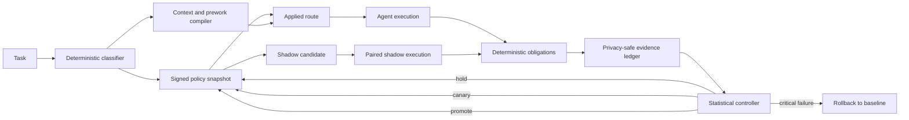

# Architecture

Agent Goodput is a control layer around an agent harness. It does not replace the harness, proxy model traffic, or patch model internals. Its job is to decide which efficiency experiments are safe to try and to reject savings that do not preserve verified outcomes.

## Components

### Task classifier

`classify.py` maps task text to a stable feature record and bucket. Features include task kind, risk, mutation scope, complexity, deterministic prework, sensitivity, and whether the user explicitly requested maximum quality. The fingerprint is a digest, not the prompt.

The classifier is intentionally conservative. High-stakes work, security review, external actions, sensitive work, broad changes, architecture, and explicit frontier-quality requests remain on the baseline route.

### Policy

`policy.py` contains the baseline and candidate routes. A candidate is not automatically an applied route. Each task bucket has an independent state:

1. `shadow`: collect paired evidence without changing the applied route.
2. `canary`: assign a deterministic fraction of eligible tasks.
3. `active`: apply the verified candidate to the bucket.
4. `rolled_back`: use the baseline while fresh evidence is collected.

Policy files are signed locally and linked to their parent digest. Each phase starts with a fresh evidence cursor so old results cannot be reused to skip a gate.

### Context compiler and deterministic prework

`context.py` measures each context source, removes duplicate lines outside code fences, and loads required, conditional, and optional packets in a stable order. Required context is never silently truncated.

`preflight.py` moves inventory, diff summaries, result filtering, and schema checks outside the reasoning loop. Its output is an index. The agent must still verify claims from source.

### Execution, deterministic completion, and selective escalation

`codex_runner.py` executes a route in a fresh, isolated Codex home with user rules, plugins, hooks, browser tools, and multi-agent behavior disabled by default. It captures provider-reported token totals and completed item telemetry.

`escalation.py` builds a repair packet from failed obligations only. A stronger
route does not receive raw prior reasoning or unrelated output.

`completion.py` handles one narrow mechanical failure without another model
call. It is eligible only when every failed obligation reports a missing
evidence path, a missing evidence literal, or both. Every reported literal must
already be stated in the original task or answer. Semantic, conclusion,
execution, safety, forbidden-fact, and hidden-fact failures are ineligible.
Source scope is the union of verifier-reported missing paths and paths already
cited by the answer. Each path must be a regular bounded file inside the
workspace. A missing path needs a source line matching trusted task or answer
terms, while a missing literal must occur exactly in a selected source line.
The compiler adds certificates with content hashes, line numbers, and trusted
matching terms without copying raw source lines, followed by complete
revalidation.

The benchmark adapter can execute one manifest-declared repair when every
failed evaluator type is allowlisted for independent repair. The repair route
can receive either a targeted failed-obligation packet or a clean retry of the
original task. The complete replacement answer is evaluated from scratch.
Initial and repair usage, elapsed time, and agent-run counts are added together.
A failed repair remains a failed task, and no second model repair is attempted.

`agp run` cannot infer arbitrary task obligations, so it does not automatically
repair an unverified answer. A caller must provide a deterministic evaluator or
adapter.

### Evidence and controller

`evidence.py` writes outcomes and events to a local SQLite ledger. Each event contains the prior event hash. Outcome and event insertion is one transaction.

The ledger rejects keys commonly used for raw prompts, model output, tool input, tool output, credentials, and transcripts. Project paths are represented by keyed identifiers in hook telemetry.

`stats.py` computes paired quality and token results. `controller.py` moves a bucket only when every configured gate passes. A critical candidate failure blocks promotion and triggers rollback from canary or active.

### Hooks

The plugin hook adds one compact route certificate at prompt submission, counts selected tool events, records a safe turn summary, and runs the controller at session end. Hooks fail open because Codex hooks are lifecycle helpers, not a complete security boundary.

## Trust boundaries

- The evaluator, not the candidate answer, decides whether an obligation passed.
- Deterministic completion can consume only verifier-reported missing paths and
  literals already present in the original task or answer. For a literal-only
  gap, it can inspect only paths the answer already cited. It cannot consume
  expected conclusions, hidden facts, or unrelated source content.
- Repair eligibility comes from the frozen manifest, not from the model.
- Provider token telemetry is trusted only when its source is labeled as reported.
- Hook input is treated as untrusted and reduced to allowlisted fields, counters, digests, and keyed identifiers.
- The local signing key protects accidental or unsophisticated policy tampering. It does not defend against an attacker who can read and rewrite the entire state directory.
- Installation is separate from evaluation. Dry-run is the default.
